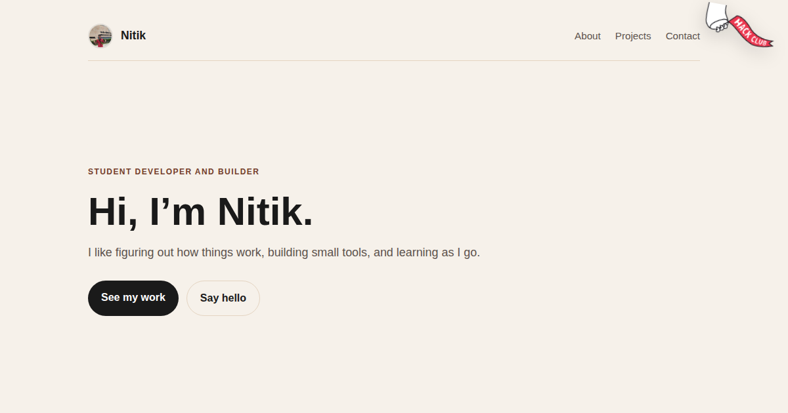

# nitikpsn.xyz

The personal site of Nitik Paswan, a student developer who builds small tools and learns by taking things apart.



**Live site: https://www.nitikpsn.xyz**

## What this is

My personal site. One page with a short intro, a little about how I got into building things, the projects I have finished so far, and ways to reach me. I kept it to one page because that is all it needs right now.

The projects are real. CTFT is a comparison and report tool for teachers. Gxpdns is a DNS auditing tool I use while learning networking and security. Both cards link straight to the source.

## Try it

Open https://www.nitikpsn.xyz in a browser. No account, no install, no build step.

## What is on it

**A single page layout.** Nav, hero, about, projects, contact and footer. Everything lives in one HTML file.

**Two project cards.** Each card says what the project does, lists the stack and links to the GitHub repo.

**A warm simple theme.** Cream background, brown accents and system fonts. It loads fast because there is not much to load.

**Responsive by default.** The about grid drops to one column on phones and the nav wraps instead of overflowing.

**No JavaScript.** The project cards are plain HTML, so the page still works with scripts turned off. Smooth scrolling comes from one CSS rule.

## Run it locally

You need a browser, and Python if you want a local server.

```sh
git clone https://github.com/Nitikpsn/nitik-personal-siite.git
cd nitik-personal-siite
python3 -m http.server 8000
```

Then open http://localhost:8000.

You can also just double click `index.html`. The local server is only there so relative paths behave the same way they do in production.

## How it works

The site is a few static files. `index.html` holds the content, `style.css` holds the styling and the images sit next to them. There is no framework and no package manager in the repo. I went this way because a portfolio does not need a build pipeline, and a static page is cheap to host and hard to break.

The layout is a centered column capped at 980px. On smaller screens the padding shrinks and the about grid becomes a single column. The Orpheus sticker is fixed in the top right corner and is purely decorative, so it never blocks a click.

## Project layout

```text
index.html
style.css
banner.png
nitik.jpg
flag-orpheus-top.png
```

## Credits

The Orpheus flag sticker is from Hack Club. The photo is mine.

## Contact

Email: nitikpsn@email.com

GitHub: https://github.com/Nitikpsn

LinkedIn: https://www.linkedin.com/in/nitik-paswan-10474b356/
