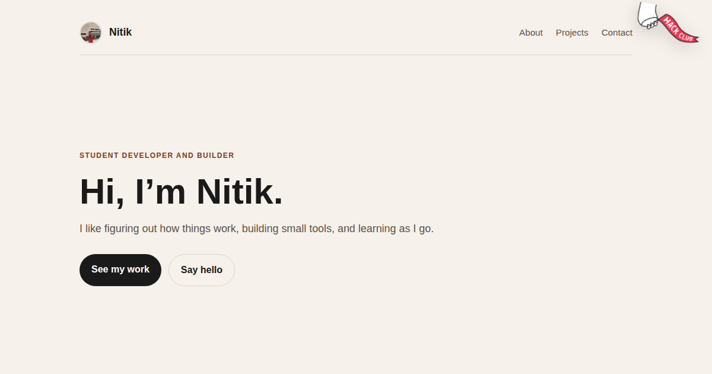

# nitikpsn.xyz

This is my personal site i try to make it for 1st time



**Live site: https://www.nitikpsn.xyz**

## What this is

My personal site. One page with a short intro, a little about how I got into building things, the projects I have finished so far, and ways to reach me. I kept it to one page because that is all it needs right now.

## What is on it

**A single page layout.**
**A personal timeline.** My story so far, in phases.
**Two project cards.** 
**A warm dark theme.** 
**Responsive by default.**
**An interactive intro heading** (TechText, ported to plain JavaScript from React Bits). 

## How it works

The site is a few static files. `index.html` holds the content, `css/style.css` holds the styling, `js/tech-text.js` powers the interactive intro heading (a vanilla JavaScript port of the React Bits TechText component), and the images live in `img/`. `favicon.ico` stays in the root because browsers ask for it there. There is still no framework and no package manager  I went this way because a portfolio does not need a build pipeline, and a static page is cheap to host and hard to break

## Project layout

```text
index.html
favicon.ico
css/style.css
js/tech-text.js
img/nitik.jpg
img/banner.png
img/flag-orpheus-top.png
img/apple-touch-icon.png
img/icon-192.png
```